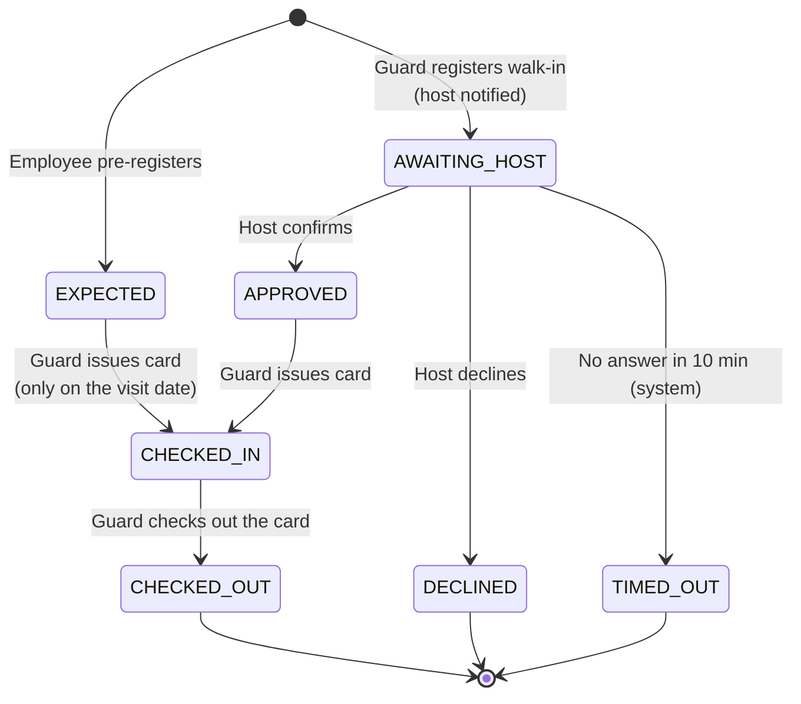
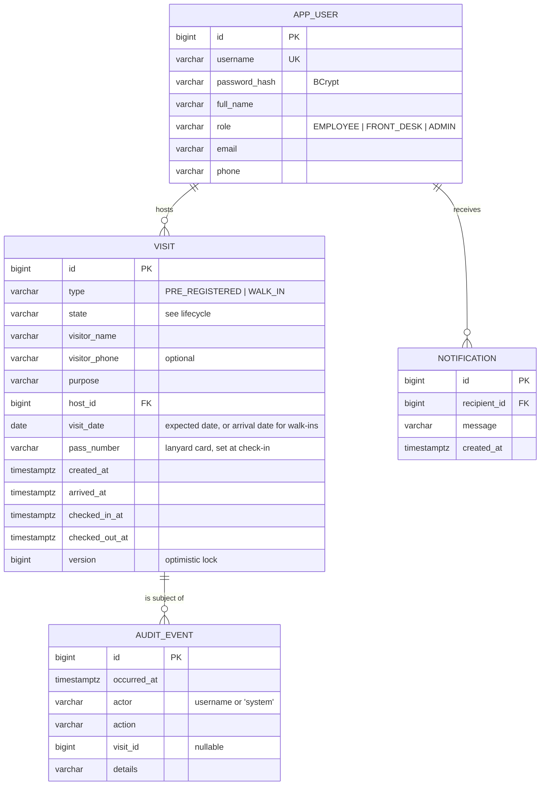
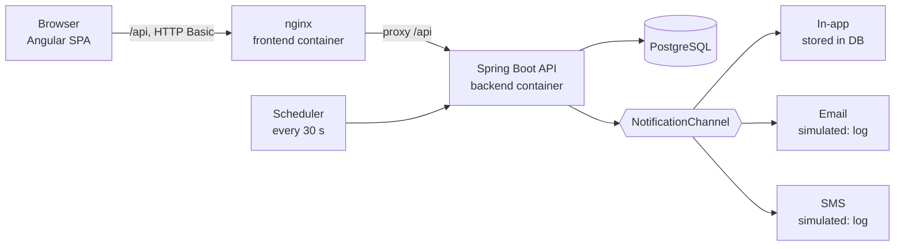

# School Visitor Management — Product Spec

| | |
|---|---|
| Status | Draft for sign-off (v1.0) |
| Client | Single K-12 campus, Philippines — ~150 employees, 40–80 visitors per school day |
| Related | [assumptions.md](assumptions.md) · [test-plan.md](test-plan.md) · [ai-usage.md](ai-usage.md) |

Sections 1–5, 7, 11 and 12 are the **business requirements** a school administrator signs off.
Sections 6, 8 and 13 are the **technical requirements** a developer builds from. Section 10 explains the
choices behind both.

---

## 1. Goals, out of scope, and how we know it works

### Goals

| # | Goal | Problem today |
|---|---|---|
| G1 | Employees tell the gate **ahead of time** who is coming. | The guard learns about a visitor only when they arrive. |
| G2 | When a visitor arrives **unannounced**, the employee they came to see is reached in seconds, and the visitor gets a clear yes or no. | The guard phones around while the visitor waits at the gate. |
| G3 | Every visit leaves a **record we can trust**: who came, who they saw, when they arrived and when they left. | Paper logbook, missing sign-outs. |
| G4 | Anyone responsible can see **who is on campus right now**, including people who should have left already. | Nobody can answer the principal's question. |

### Out of scope for this release

- More than one campus (tenant). The client has one campus.
- Printed or QR passes. The existing numbered lanyard cards are the pass (decision D1).
- Real email/SMS providers. Both channels are simulated behind an interface.
- Visitor self-service kiosk, ID scanning, photos, watch lists.
- Student release / parent pick-up workflows.
- User management screens (accounts are seeded), reports and analytics.
- Cancelling a pre-registration and the data-retention purge job (ranked *Should*, see §12).

### How the school will know the system is working

| Measure | Target after 1 month | Source |
|---|---|---|
| Visits with a recorded arrival **and** departure (or an open "on campus" entry the guard can see) | 100 % | Visit records |
| Visitors still checked in at end of the school day | 0, or each one explained | On-campus view |
| Walk-ins that waited longer than 10 minutes without a decision | 0 (the timeout gives every walk-in an outcome) | Audit trail |
| Median time from walk-in registration to host decision | < 3 minutes | Audit trail |
| Share of visits pre-registered instead of walk-in | ≥ 60 % | Visit records |
| Time for the principal to see the on-campus count | < 5 seconds | Dashboard |

---

## 2. Users and roles

Every user has exactly one role. The server enforces every rule below; the UI only hides what a role cannot use.

| Role | Who | Can | Cannot |
|---|---|---|---|
| **EMPLOYEE** (host) | Teachers and staff (~150) | Pre-register their own visitors; see visits where they are the host; confirm or decline walk-ins that named them; see their in-app notifications. | See other employees' visits; check visitors in or out; respond for another employee; read the audit trail. |
| **FRONT_DESK** | Guards at the main gate | See the employee directory (names only); register walk-ins; check in visitors and issue a lanyard card; check visitors out; see today's visits and who is on campus. | Pre-register visitors; confirm or decline on behalf of a host; read the audit trail. |
| **ADMIN** | Principal, school admin office | See today's visits and who is on campus (including overstays); read the audit trail. | Change any visit. Oversight is read-only, which keeps duties separate. |
| *System* | Scheduled job | Time out walk-ins nobody answered. | Anything else. |
| *Visitor* | Guests, parents, suppliers | No login. They are the subject of the personal data. | — |

---

## 3. User stories and acceptance criteria

IDs (AC-x.y) are referenced by the traceability table in [test-plan.md](test-plan.md).

### US-1 Pre-register a visitor — *as an employee, I tell the gate who is coming so they are let in without delay.*

- **AC-1.1** Given I am signed in as an employee, when I submit a visitor name, a purpose and a visit date of today or later, then a visit is created in state `EXPECTED` with me as host, and it appears on the front desk's list for that date.
- **AC-1.2** Given a visit date in the past, when I submit, then the request is rejected and nothing is saved.
- **AC-1.3** Given I am front desk or admin, when I try to pre-register, then I am refused (403).

### US-2 Check in a pre-registered visitor — *as a guard, I let an expected visitor in and hand them a card.*

- **AC-2.1** Given an `EXPECTED` visit for today, when I check the visitor in with lanyard card *N*, then the visit becomes `CHECKED_IN`, arrival and check-in time are recorded, card *N* is the visitor's pass, and the host is notified that their visitor has arrived.
- **AC-2.2** Given an `EXPECTED` visit for another date, when I try to check it in, then it is refused; I register the person as a walk-in instead.
- **AC-2.3** Given card *N* is held by someone still on campus, when I issue card *N* to another visitor, then it is refused.

### US-3 Register a walk-in — *as a guard, I record an unannounced visitor and reach their host without phoning around.*

- **AC-3.1** Given a visitor who was not pre-registered, when I enter their name, purpose and the employee they came to see, then a visit is created in state `AWAITING_HOST`, the arrival time is recorded, and that employee is notified in the app, by email and by SMS (simulated).
- **AC-3.2** Given a visit is `AWAITING_HOST`, when I try to issue a card, then it is refused: no pass before the host confirms.
- **AC-3.3** Given a missing name, purpose or host, or a host who is not an employee, when I submit, then it is rejected and nothing is saved.

### US-4 Confirm or decline a walk-in — *as an employee, I decide whether an unannounced visitor is my guest.*

- **AC-4.1** Given a walk-in is waiting for me, when I confirm, then the visit becomes `APPROVED` and the front desk sees it ready for a card.
- **AC-4.2** Given a walk-in is waiting for me, when I decline, then the visit becomes `DECLINED` and no card can ever be issued for it.
- **AC-4.3** Given a walk-in is waiting for another employee, when I try to confirm or decline it, then I am refused (403).
- **AC-4.4** Given a walk-in that is already approved, declined or timed out, when anyone responds, then it is refused (409) and the first decision stands.

### US-5 No answer from the host — *as a guard, I get a clear outcome instead of waiting indefinitely.*

- **AC-5.1** Given a walk-in has been `AWAITING_HOST` for more than 10 minutes, when the system runs its check (every 30 seconds), then the visit becomes `TIMED_OUT`, the audit trail records actor `system`, and the front desk sees "no response — entry not granted". The guard may register the visitor again, which notifies the host again, or name another employee.

### US-6 Check out — *as a guard, I close the visit when the card is returned.*

- **AC-6.1** Given a `CHECKED_IN` visit holding card *N*, when I check out card *N*, then the visit becomes `CHECKED_OUT` with the departure time; card *N* no longer identifies that visit (the pass is no longer valid) and can be handed to the next visitor.
- **AC-6.2** Given no visitor on campus holds card *N*, when I check out card *N*, then it is refused (404).

### US-7 Who is on campus now — *as the principal or a guard, I can answer "how many visitors are on campus?" at any moment.*

- **AC-7.1** Given visitors are checked in, when I open the dashboard, then I see the number of visitors on campus and, for each one, the visitor, host, card and check-in time. The view refreshes automatically.
- **AC-7.2** Given a visitor checked in more than 4 hours ago (including on a previous day), then they are flagged **overstayed**.
- **AC-7.3** Given I am an employee, when I request the on-campus view, then I am refused (403).

### US-8 Audit trail — *as the principal, I can see who did what and when.*

- **AC-8.1** Given any visit is created or changes state, or a notification is sent or fails, then an audit event is stored with time, actor, action, visit and details.
- **AC-8.2** Given I am an admin, when I open the audit trail, then I see the newest events first. Other roles are refused (403). There is no way to edit or delete events.

### US-9 Access control — *as the school, I trust that each person can do only what their role allows.*

- **AC-9.1** Given I am not signed in, when I call any API, then I get 401.
- **AC-9.2** Given I am signed in, when I call an API outside my role (§2), then I get 403, whatever the UI shows.

---

## 4. Visit lifecycle

| From | Event | Actor | To | Guard condition |
|---|---|---|---|---|
| — | pre-register | Employee | `EXPECTED` | Visit date ≥ today |
| — | register walk-in | Front desk | `AWAITING_HOST` | Host is an employee |
| `AWAITING_HOST` | confirm | The host only | `APPROVED` | — |
| `AWAITING_HOST` | decline | The host only | `DECLINED` | — |
| `AWAITING_HOST` | timeout | System | `TIMED_OUT` | Waiting > 10 min |
| `EXPECTED` | check in (issue card) | Front desk | `CHECKED_IN` | Visit date = today; card not held by anyone on campus |
| `APPROVED` | check in (issue card) | Front desk | `CHECKED_IN` | Card not held by anyone on campus |
| `CHECKED_IN` | check out | Front desk | `CHECKED_OUT` | — |

Every other combination is rejected (HTTP 409) and leaves the visit unchanged. Specifically:

- A pass (card number) exists only from `CHECKED_IN` on; there is no path to `CHECKED_IN` that skips host
  confirmation or pre-registration.
- `CHECKED_OUT`, `DECLINED` and `TIMED_OUT` are final.
- **Overstayed** is a derived flag, not a state: `CHECKED_IN` and checked in more than 4 hours ago.

The rules are enforced in three layers: the `Visit` entity's methods (the only way to change state), database
constraints (a card can be held by only one checked-in visit; checked-in and checked-out visits must have
their timestamps and card), and optimistic locking (two concurrent changes to one visit cannot both win).

---

## 5. Flows

### Main flow A — pre-registered visitor

1. The employee pre-registers the visitor: name, optional mobile number, purpose, date.
2. On that date the visitor arrives at the gate. The guard finds them in **Expected today**, checks their ID by sight, hands a lanyard card and enters its number.
3. The visit becomes `CHECKED_IN`; the host gets an "arrived" notification.
4. On leaving, the visitor returns the card. The guard enters the card number at **Check out**; the visit becomes `CHECKED_OUT`.

### Main flow B — walk-in visitor

1. The guard registers the visitor: name, optional mobile number, purpose, and the employee they came to see (picked from the directory).
2. The host is notified in the app, by email and by SMS (simulated). The visitor waits at the gate.
3. The host confirms in the app. The guard's screen shows the visit as **Approved** within 5 seconds.
4. The guard hands a lanyard card and enters its number; the visit becomes `CHECKED_IN`.
5. Check-out as in flow A.

### Alternative and exception flows

| Situation | What happens |
|---|---|
| Host declines | Visit `DECLINED`. The guard tells the visitor; entry is not granted. The record is kept. |
| Host does not answer in 10 minutes | Visit `TIMED_OUT` (deny by default, decision D3). The guard may register again, which notifies the host again, or name another employee. |
| Pre-registered visitor comes on another day | Check-in is refused; the guard registers them as a walk-in and the host confirms. |
| Visitor names someone the guard cannot find | The guard selects the relevant office's account (for example the admin office). |
| A notification channel fails | The other channels are still tried; the failure is written to the audit trail; the in-app notification is stored in our own database. The timeout still bounds the wait. |
| Visitor leaves without returning the card | The visit stays `CHECKED_IN` and becomes **overstayed** after 4 hours. The guard checks it out from the on-campus list; the audit trail shows who closed it and when. |
| Card lost | The guard checks the visit out from the on-campus list, so the card number is released. |
| Two guards issue the same card at the same moment | The database allows one; the other gets "card already in use". |
| Host confirms at the same moment the timeout fires | Optimistic locking lets one change win; the other gets 409. |
| Host clicks confirm twice | The second click gets 409; the visit is unchanged. |
| Approved walk-in leaves before getting a card | The visit stays `APPROVED`; it leaves the desk's list the next day (no pass was ever issued). |
| System or network down | The guard falls back to the paper logbook (operating procedure). Back-filling is not supported in this release (risk R3). |

---

## 6. Data model

Database constraints that keep invalid data out even if the code has a bug:

- `CHECK` that `CHECKED_IN` and `CHECKED_OUT` visits have a `pass_number` and `checked_in_at`, and `CHECKED_OUT` visits have `checked_out_at`.
- Partial unique index on `pass_number` where `state = 'CHECKED_IN'`: a card is held by at most one visitor at a time and is free again after check-out.
- `CHECK` constraints on `type`, `state` and `role` values.

Volume is about 30,000 visits a year, so no extra indexes are needed in this release. Schema changes are versioned
Flyway migrations.

---

## 7. Notifications

| Event | Recipient | Channels | Message |
|---|---|---|---|
| Walk-in registered | Host | In-app, email, SMS | "Walk-in visitor {name} is at the main gate to see you (purpose: {purpose}). Please confirm or decline in EduSuite Visitors within 10 minutes." |
| Pre-registered visitor checked in | Host | In-app, email, SMS | "Your visitor {name} has checked in at the main gate (card {n})." |

- **In-app:** stored in the `notification` table and shown on the employee's screen, which refreshes every 5 seconds. Walk-ins waiting for the employee are also listed with Confirm / Decline buttons.
- **Email and SMS:** simulated. The message is written to the backend log with the recipient's fictional address or number.
- **Design:** every channel implements one `NotificationChannel` interface. Adding a real provider means adding one class; the visit logic does not change.
- **When a channel fails:** each channel is called separately. A failure is logged and written to the audit trail (`NOTIFICATION_FAILED`, with the channel). The visit is still saved and the other channels still run. Because the 10-minute timeout gives every walk-in an outcome, a silent channel cannot leave a visitor waiting indefinitely. In production, sending moves to a transactional outbox with retries (§12).
- Messages contain the visitor's name and purpose only; no phone numbers.

---

## 8. Non-functional requirements

### Security

- Every API except sign-in requires authentication. Users are seeded with BCrypt-hashed passwords and authenticate with HTTP Basic (stateless). Production uses the school's SSO over HTTPS (decision D7).
- Authorisation is enforced on the server: URL rules per role in one place (`SecurityConfig`), plus an ownership check (only the named host can confirm or decline). Unauthenticated requests get 401; requests outside the role get 403.
- Input is validated (required fields, lengths) and rejected with 400 and an RFC 9457 problem body. Errors never return stack traces.
- CSRF protection is not needed because credentials travel in a header, never in cookies.
- Secrets (database password) come from environment variables; the values in `docker-compose.yml` are for local use only.

### Auditability

- The audit trail is append-only: the application has no update or delete path for audit events, and none is exposed in the API. Production adds database grants that deny `UPDATE` and `DELETE` on `audit_event`.
- Each event records the time (UTC), actor username (or `system`), action, visit and details. A state change and its audit event are saved in the same transaction, so neither exists without the other.

### Performance at the front desk

- Registering a walk-in takes under 60 seconds of guard time: four fields, and the host is picked from a list.
- API responses p95 < 300 ms at the expected load (80 visits a day, 1–3 desk screens, 150 employees refreshing every 5 seconds is about 30 requests a second at the worst moment).
- Desk and employee screens refresh every 5 seconds, so a host's decision appears at the gate within 5 seconds.

### Visitor personal data (Data Privacy Act of 2012, RA 10173)

- **Collected:** visitor name, purpose, and optionally a mobile number. No ID numbers, photos or addresses. The guard sights an ID but does not record it.
- **Protected:** only front desk and admin see visitor data for the whole school; employees see only their own visitors. Transport is HTTPS in production.
- **Retained:** visit records are kept for 1 year, then visitor name and phone are anonymised and the visit counts are kept. The purge job is designed but not built in this release (§12). The school's Data Protection Officer confirms the period (assumption A15).
- **Informed:** a privacy notice is posted at the gate (operating procedure, outside the software).
- Simulated email and SMS logs contain visitor names; production log retention must follow the same policy.

### Time

- "Today" is computed in the school's time zone (Asia/Manila). Timestamps are stored as UTC instants and shown in the browser's local time.

---

## 9. Assumptions

The full list, each with reasoning and the impact if it is wrong, is in [assumptions.md](assumptions.md). The ones that shape the design most:

- **A4** The numbered lanyard cards already in use are the visitor pass.
- **A6** A host has 10 minutes to answer; no answer means no entry.
- **A7** "Overstayed" means checked in for more than 4 hours.
- **A8** A pre-registration is valid only on its date.
- **A9** Pre-registering counts as the host's confirmation; no second confirmation at arrival.
- **A12** The admin role is read-only oversight.

---

## 10. Key decisions and trade-offs

| # | Decision | Alternatives rejected | Why |
|---|---|---|---|
| D1 | **The pass is the existing numbered lanyard card**; the guard enters its number at check-in, and the number is unique among visitors on campus. | System-generated code; printed or QR badge. | No printer at the gate, and no change to the physical process. "The pass stops being valid" is enforced by the database: the card number points to a visit only while it is `CHECKED_IN`. A printed or QR pass is a later upgrade (ranked Should/Could). |
| D2 | A confirmed walk-in goes to `APPROVED`; the guard then issues the card. | Confirmation checks the visitor in directly. | The pass is physical, so the moment the guard hands it over is the real check-in. Both flows end with the same "issue card" step. |
| D3 | **Timeout denies entry** (`TIMED_OUT`). | Admit automatically; escalate to the admin office. | Safeguarding on a K-12 campus: nobody gets in without a staff member vouching for them. Escalation is the next step (Could). |
| D4 | Overstayed is calculated, not stored. | An `OVERSTAYED` state set by a job. | One rule, nothing to keep in sync, and it is correct the moment the rule changes. |
| D5 | State changes live in the `Visit` entity, backed by DB constraints and optimistic locking. | Status checks scattered in services or controllers. | Invalid transitions are impossible to write by accident, and the rules are unit-testable without a database. |
| D6 | Notifications are sent synchronously inside the request, each channel isolated. | Transactional outbox with an async worker. | Simple and enough for simulated channels. With real providers the outbox becomes necessary (§12). |
| D7 | HTTP Basic with seeded users. | JWT; OAuth2 / OIDC. | The exam allows simple auth. Production uses the school's Google or Microsoft SSO. |
| D8 | Screens poll every 5 seconds. | WebSockets / server-sent events. | About 30 requests a second at most; simpler to build and operate. |
| D9 | Single tenant. | `tenant_id` on every table from day one. | The client is one campus. Adding tenants later means a `tenant_id` column and a filter, recorded as a Could. |
| D10 | Visitor details are stored on the visit. | A separate `visitor` table with history. | We do not need to recognise returning visitors, and not building a visitor database keeps personal data to a minimum. |
| D11 | Admin is read-only. | Admin can override or act on visits. | Separation of duties: the people who audit are not the people who act. |
| D12 | **Stack:** Java 21, Spring Boot 4.1, PostgreSQL 17, Angular 22, Playwright, Testcontainers, Docker Compose. | Spring Boot 3.x as suggested. | Same programming model, but Spring Boot 3.5's open-source support ended in June 2026 and Spring Initializr now generates 4.x only, so a new module should start on the supported line. |

---

## 11. Risks and mitigations

| # | Risk | Likelihood / impact | Mitigation |
|---|---|---|---|
| R1 | Hosts ignore notifications, so visitors are turned away. | Medium / Medium | SMS in addition to in-app; the 10-minute timeout; track decision times; escalation to the admin office as the next feature. |
| R2 | Visitors leave without checking out, so the on-campus count is wrong. | High / Medium | Overstayed flag; the guard reviews the on-campus list at closing; card deposit procedure (for example, the guard holds the visitor's ID until the card is returned). |
| R3 | The system is down at the gate. | Low / High | Paper logbook fallback procedure. Back-filling paper entries is a production requirement (§12). |
| R4 | Shared or weak guard passwords. | Medium / High | Individual accounts; SSO with MFA in production; audit shows each actor. |
| R5 | Visitor personal data leaks. | Low / High | Data minimisation, role-based access, retention policy, HTTPS. |
| R6 | The guard types the wrong card number. | Medium / Low | Card uniqueness check; the on-campus list shows name and card side by side for correction. |
| R7 | Employees do not adopt pre-registration. | Medium / Medium | Two-field form; principal's memo; measure the pre-registered share (§1). |

---

## 12. Scope and priorities

Ranking rule: **Must** = without it the problem statement is not solved, or the record cannot be trusted.
**Should** = valuable and cheap, but the process works without it. **Could** = needed only beyond this client's
context. All Musts are built; no Should or Could is built in this exam.

| Capability | Priority | Why | Built |
|---|---|---|---|
| Employee pre-registers a visitor | Must | Goal G1. | ✅ |
| Front desk checks in a pre-registered visitor and issues a pass | Must | Goal G1; start of the trusted record. | ✅ |
| Front desk registers a walk-in and names the host | Must | Goal G2. | ✅ |
| Host is notified in the app (email and SMS simulated) | Must | Goal G2: no more phoning around. | ✅ |
| Host confirms or declines; pass only after confirmation | Must | Explicitly required; core safeguarding rule. | ✅ |
| Check-out with the pass; the pass stops being valid | Must | Goal G3: "when they left". | ✅ |
| Defined outcome when the host does not respond | Must | Without it a walk-in can stay unresolved forever; the waiting visitor is the client's main complaint. | ✅ |
| Live on-campus view, including overstays | Must | Goal G4: the principal's question. | ✅ |
| Audit trail of who did what, when | Must | Goal G3: a record the school can trust. | ✅ |
| Role-based access enforced on the server | Must | Without it nothing else can be trusted. | ✅ |
| CI pipeline (GitHub Actions) | Must | The guardrail that keeps every Must working as the team changes code; cheap to add. | ✅ |
| Printable pass | Should | The lanyard card already serves as the pass (D1). | — |
| *Own:* cancel a pre-registration | Should | Keeps the expected list clean; stale entries already drop off after their date. | — |
| *Own:* retention purge or anonymisation job | Should | Required by policy before go-live, but has no effect in the first year. | — |
| QR code pass | Could | Only useful with self-service scanning. | — |
| More than one school (tenant) | Could | One campus in context (D9). | — |
| *Own:* escalate timeouts to the admin office | Could | Improves on D3 once response data exists. | — |

### What a full production release would also need

School SSO with MFA and HTTPS; real email/SMS providers behind the same interface, with a transactional outbox and
retries; the retention job; user management and an HR sync for the employee directory; back-filling entries made
on paper during outages; backups, monitoring and alerting; accessibility review of the gate screen; a privacy
notice and DPO sign-off; load and penetration testing.

---

## 13. Technical design

### Architecture

Backend packages: `visit` (entity, service, controller, timeout job), `user`, `notification` (interface and channels),
`audit`, `config` (security, clock, seed data). Controllers are thin; `VisitService` loads the visit, checks
ownership, calls the entity method, writes the audit event and sends notifications in one transaction.

### REST API

All endpoints are under `/api`, use JSON, and return errors as RFC 9457 `application/problem+json`.

| Method | Path | Role | Body | Success |
|---|---|---|---|---|
| GET | `/api/me` | any signed in | — | `200` current user `{id, username, fullName, role}` |
| GET | `/api/employees` | FRONT_DESK | — | `200` `[{id, fullName}]` hosts to choose from |
| POST | `/api/visits/pre-registrations` | EMPLOYEE | `{visitorName, visitorPhone?, purpose, visitDate}` | `201` Visit (`EXPECTED`) |
| POST | `/api/visits/walk-ins` | FRONT_DESK | `{visitorName, visitorPhone?, purpose, hostId}` | `201` Visit (`AWAITING_HOST`) |
| POST | `/api/visits/{id}/confirm` | EMPLOYEE (host) | — | `200` Visit (`APPROVED`) |
| POST | `/api/visits/{id}/decline` | EMPLOYEE (host) | — | `200` Visit (`DECLINED`) |
| POST | `/api/visits/{id}/check-in` | FRONT_DESK | `{passNumber}` | `200` Visit (`CHECKED_IN`) |
| POST | `/api/visits/check-out` | FRONT_DESK | `{passNumber}` | `200` Visit (`CHECKED_OUT`) |
| GET | `/api/visits/today` | FRONT_DESK, ADMIN | — | `200` visits dated today, plus everyone checked in |
| GET | `/api/visits/mine` | EMPLOYEE | — | `200` visits I host, newest first |
| GET | `/api/notifications` | any signed in | — | `200` my in-app notifications, newest first |
| GET | `/api/audit` | ADMIN | — | `200` latest 200 audit events |

Visit JSON: `{id, type, state, visitorName, visitorPhone, purpose, hostId, hostName, visitDate, arrivedAt, checkedInAt, checkedOutAt, passNumber, overstayed}`.

Errors: `400` invalid input · `401` not signed in · `403` role or ownership · `404` unknown visit, host or card ·
`409` the request breaks a lifecycle rule (wrong state, wrong date, card in use, concurrent change).

### Configuration

| Property | Default | Meaning |
|---|---|---|
| `visitors.zone` | `Asia/Manila` | Time zone that defines "today" |
| `visitors.host-response-timeout` | `PT10M` | How long a walk-in waits for the host |
| `visitors.max-stay` | `PT4H` | When a checked-in visitor counts as overstayed |
